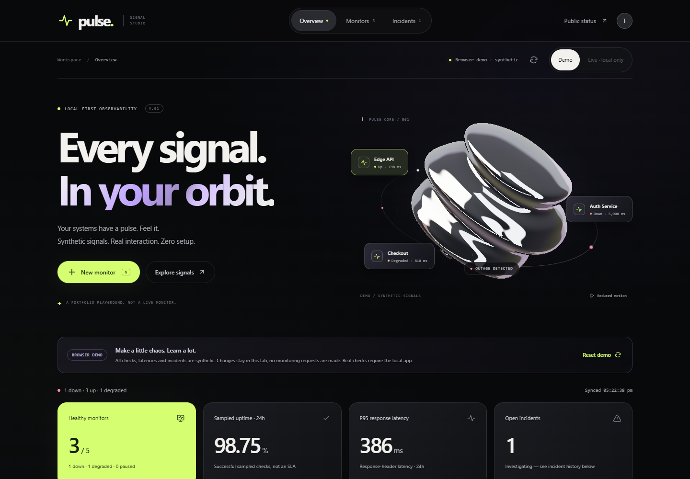
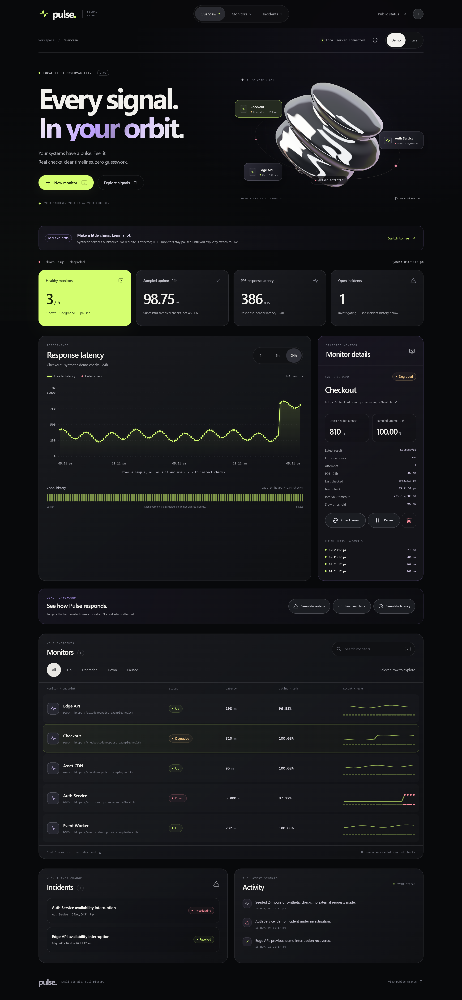
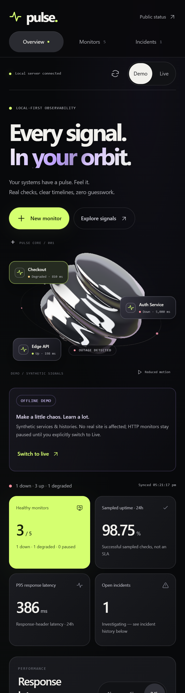
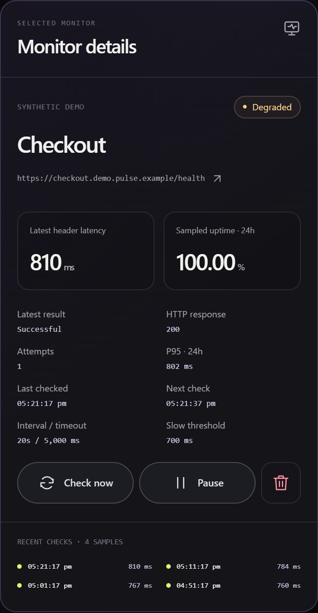
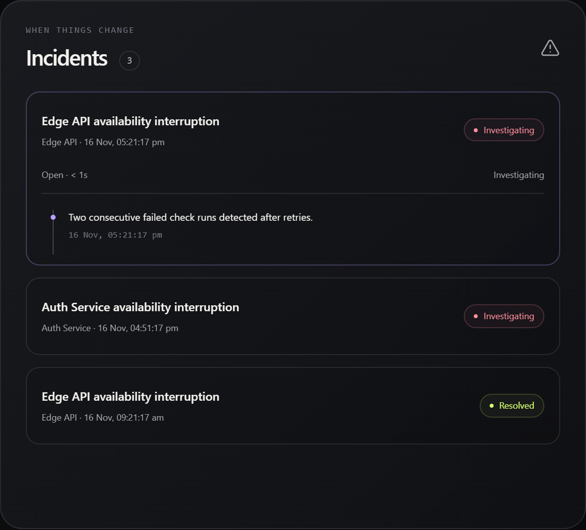
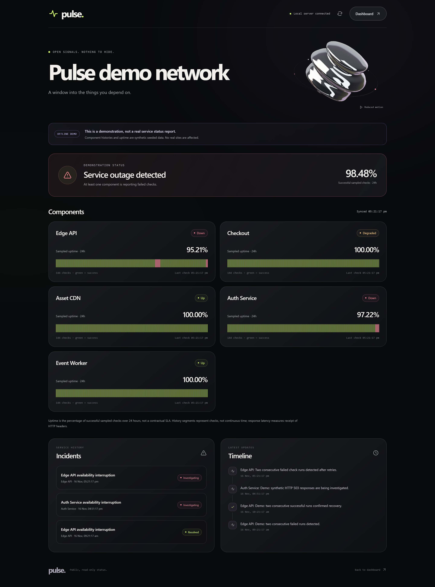

# Pulse · Signal Studio

### Every signal. In your orbit.

A 3D-animated monitoring console that turns uptime, latency and incidents into a living signal system. A custom WebGL sculpture up front; native TypeScript, SQLite and a guarded HTTP checker underneath.

[](https://github.com/TUSHANT-CSE/pulse/actions/workflows/pages.yml)
[](https://tushant-cse.github.io/pulse/)


**[Open interactive demo](https://tushant-cse.github.io/pulse/)** · **[Explore status page](https://tushant-cse.github.io/pulse/status/)** · [Run locally](#run-locally) · [Architecture](#architecture) · [Testing](#testing)

[](https://tushant-cse.github.io/pulse/)

Built by [Tushant](https://github.com/TUSHANT-CSE). No accounts, paid APIs, remote fonts, or production npm dependencies.

## Try the interactive demo

The GitHub Pages edition is a **browser-only portfolio playground**. Every service, latency, uptime percentage and incident is synthetic—not a claim about a real website. It does not run a backend or send HTTP monitoring requests.

1. Select a floating signal or monitor row; explore its latency chart and check history.
2. Try **Simulate outage**, **Recover demo**, and **Simulate latency** to see incident transitions.
3. Add a synthetic monitor, generate a sample with **Check now**, pause/resume it, or remove it.
4. Open the status view, toggle **Pause motion**, or use **Reset demo** to restore the seed.

Changes remain in the current tab's session storage and survive navigation/reloads when storage is available. Other visitors see their own isolated demo. No background scheduler runs; controls generate synthetic samples. **Live is intentionally disabled** on Pages.

| | Hosted portfolio demo | Full local application |
| --- | --- | --- |
| Data | Synthetic browser state | SQLite history on your machine |
| Checks | Manual synthetic samples only | Scheduled public HTTP/HTTPS checks with retries |
| Incidents | Simulated outage/recovery transitions | Two failed runs open; two successful runs resolve |
| Status view | Shareable demonstration | Read-only view on the local server |
| Requirements | Modern browser | Node.js 22.18+ |

> The local dashboard has no production authentication. Keep it bound to loopback; do not expose the Node server through a tunnel or reverse proxy without adding authentication and deployment hardening. Only the isolated synthetic build is published to Pages.

## Visual demo

These are screenshots of the actual running application, captured using an isolated in-memory SQLite database. All pictured service names, latencies, availability history, and incidents are deliberately synthetic Demo data—not claims about real services. Capturing them does not reset the user's persistent workspace.

### Dashboard



### Mobile

<table>
  <tr><th>Phone overview</th><th>Selected monitor</th></tr>
  <tr>
    <td></td>
    <td></td>
  </tr>
</table>

### Incident timeline



### Read-only status view



## Signal Studio

An original interface inspired by [ReactDrops](https://reactdrops.dev/): a near-black canvas, oversized refracted typography, acid-lime metrics, lavender glass panels, and a living chrome signal sculpture. No ReactDrops component code or media is included; the implementation uses native browser APIs rather than adding React or a 3D dependency.

The sculpture uses a custom WebGL raymarched surface and procedural studio reflections. Its accent responds to aggregate health; its shape and satellites are decorative, not measurements. Floating monitor cards select actual monitors and update the chart and details. They stop drifting on hover or keyboard focus. Panels have pointer-follow lighting, metric cards tilt gently, and sections reveal on scroll.

**Pause motion** freezes the sculpture, floating cards, and decorative panel effects without stopping monitoring. The choice survives reloads in the current tab. System reduced-motion preferences take priority. Rendering is capped at 30 fps and a 1.5 pixel ratio, stops offscreen or in a hidden tab, and falls back to an original projected Canvas2D sculpture if WebGL is unavailable or loses its context. All assets are local; the existing script CSP remains intact.

## Run locally

Requires **Node.js 22.18 or newer** with its built-in SQLite module. Verified on Windows with Node 26.13 and Microsoft Edge.

### Windows: no terminal typing

Open this folder in File Explorer and double-click **Open Pulse.cmd**. The supplied launcher uses `C:\Program Files\nodejs\node.exe`, starts the server, and opens your default browser. Keep its window open while monitoring; closing it stops the application. If Pulse is already running on the default port, the launcher opens that existing instance instead.

- Dashboard: <http://127.0.0.1:4310/>
- Read-only status view: <http://127.0.0.1:4310/status>

The supplied Windows launcher assumes Node's standard installation location. If Node is installed elsewhere, adapt the launcher path, or use the developer commands below.

### Developer commands

```sh
npm ci
npm run dev
```

Development packages are needed for building and testing, not for running the native source server. With a compatible Node installation, `node src/server.ts` works without `npm ci`.

```sh
npm run build
npm start
```

The build compiles TypeScript to `dist/server` and copies local browser assets to `dist/public`. No bundler or CDN is required.

### Your first real monitor

1. Start in **Demo**. Five seeded services and approximately 24 hours of synthetic samples are available offline. Try **Simulate outage**, **Recover demo**, and **Simulate latency**. Scenarios target the first remaining seeded monitor and affect no real website.
2. Click **New monitor**, enter a name and a public HTTP/HTTPS URL, then create it. Creation validates public DNS; it requires network access for domain names. The new monitor stays paused in Demo.
3. Explicitly choose **Live** and confirm. Only enabled real HTTP monitors run; synthetic monitors pause. Use **Check now**, **Pause**, and **Resume** to inspect behavior.
4. Select a monitor to view its chart and details. Search or filter the table, change chart ranges, and expand incidents to see their event history.

Mode changes preserve stored monitors and histories. `N` opens the create dialog; `/` focuses search. Chart samples support left/right arrow navigation. Dialogs support Tab, Shift+Tab, and Escape; reduced-motion preferences are respected.

### Persistence and configuration

The default database is `data/pulse.sqlite`, relative to the launch directory. Settings, monitor definitions, check results, incidents, and activity survive restarts. The Windows launcher always runs from this project folder.

Optional environment variables:

| Variable | Default | Purpose |
| --- | --- | --- |
| `PORT` | `4310` | Local HTTP port, 1–65,535 |
| `PULSE_DB` | `data/pulse.sqlite` | SQLite database path; `:memory:` is intended for programmatic test stores, not this CLI variable |

Raw check retention is approximately 25 hours, resolved incidents 30 days, and activity 200 events. API history includes all open incidents and up to 100 recent resolved incidents. Charts expose at most 144 sampled points while metrics use the underlying raw checks.

## Features

- Scheduled GET checks with bounded per-attempt deadlines, one retry, and a four-check concurrency budget shared by manual and scheduled work. Requests for the same monitor coalesce; pausing, deleting, or changing mode cancels unfinished work without recording a false outage.
- Public-address safeguards: reject local/private/reserved IPs and hostnames, vet every DNS result, pin sockets to vetted addresses, try alternate vetted addresses on connection failures, and revalidate every redirect. Maximum three redirects per attempt. No cookies or response bodies are stored.
- Incident state machine: one failed run is degraded; two consecutive failed runs open one incident. Two consecutive successful runs resolve it. Each run already includes retry policy. A slow successful response is degraded but does not itself create an availability incident.
- Summary metrics, per-monitor latency charts, sampled-check history, search/status filters, native dialogs, activity stream, explicit errors, and responsive phone/tablet/desktop layouts.
- SSE update notifications with reconnect/resynchronization and visible-only fallback polling. Hidden pages suspend background reads and streams. Disconnected views keep last-known data with a stale warning and disable mutation actions.
- Read-only `/status` presentation and `/api/status` data exclude endpoint URLs. Names, sampled histories, and incidents remain visible; choose names suitable for sharing. An empty or entirely paused network is shown as unknown, not falsely operational.

## How measurements work

**Sampled availability** is successful checks divided by all checks in the last 24 hours. It is not continuous elapsed uptime or a contractual SLA. No samples means unknown, not 100%.

**Response-header latency** measures the time to receive final response headers, including DNS, connection, and redirect work for that attempt. It does not measure full-body download time. HTTP 200–399 is considered successful. Failed-run durations are not included in successful-response percentiles.

**Percentiles** use nearest-rank over successful raw samples. The dashboard displays P95; monitor detail APIs also expose P50/P95/P99. History bars represent discrete samples, not equal-duration uptime intervals.

## Architecture

```text
Browser: local HTML / CSS / JavaScript modules
  ├─ GET dashboard or read-only status JSON
  ├─ POST / PATCH / DELETE local actions
  └─ EventSource notifications → refetch current state
                 │
Native Node HTTP server: Host / Origin / JSON / static guards
                 │
PulseService: scheduler, shared concurrency, mode and incident state
        ├─ HTTP checker → vetted DNS → pinned socket → headers
        ├─ deterministic synthetic Demo simulator
        └─ SQLite Store → atomic checks / counters / incidents / activity
```

| File | Responsibility |
| --- | --- |
| `src/server.ts` | Local server, routes, SSE, security headers, lifecycle and browser launch |
| `src/service.ts` | Monitor validation, scheduling, cancellation, incident transitions and public projections |
| `src/checker.ts` | Native HTTP/HTTPS transport, redirects, fallback, deadlines and retries |
| `src/url-safety.ts` | URL parsing, reserved-network rejection and DNS vetting |
| `src/store.ts` | SQLite schema, transactions, retention and deterministic demo seed |
| `src/metrics.ts` | Windowed sampled availability, percentiles and bounded chart downsampling |
| `public/` | Responsive Signal Studio dashboard and read-only status interface; no external assets |
| `public/js/scene.js` | Original WebGL sculpture, Canvas2D fallback, rendering budget and motion lifecycle |
| `scripts/build-pages.mjs` | Isolated Pages export from a fresh in-memory synthetic seed; never reads the persistent database |
| `scripts/pages-demo.js` | Browser-only interaction simulator, session persistence and explicit reset |
| `.github/workflows/pages.yml` | Verify the full app, then publish only `dist-pages/` |

### Separate deployment boundary

```text
GitHub Actions: typecheck → backend tests → browser tests → Pages tests
                                                         │
                                 Fresh in-memory demo seed + static assets
                                                         │
                                             GitHub Pages /pulse/
                                                         │
                                   Browser-only state in each visitor's tab

Never published: SQLite databases, local HTTP server, HTTP checker, secrets
```

`npm run build:pages` generates `dist-pages/`. Both dashboard and `/status/` use relative asset paths, so the build works beneath a repository subpath. The browser reuses the same metrics functions and UI; a separate transport handles simulated interactions. The local application does not serve the hosted transport. A restrictive script CSP keeps both editions free of inline or remote executable code.

## Local API

All writes require `Content-Type: application/json` and a JSON object, including `{}` for check/delete. Cross-origin writes and untrusted Host headers are rejected. This is a local-only API, not a substitute for authentication.

| Method | Route | Purpose |
| --- | --- | --- |
| GET | `/health` | Local server health; not monitored-service health |
| GET | `/api/dashboard` | Administrative monitor summary, incidents and activity |
| GET | `/api/status` | Read-only component projection without endpoint URLs |
| GET | `/api/events` | SSE `update` notifications |
| POST | `/api/monitors` | Create a public HTTP monitor |
| GET | `/api/monitors/:id` | Monitor history, incidents and detailed metrics |
| PATCH | `/api/monitors/:id` | Change enabled/name/interval/slow threshold |
| DELETE | `/api/monitors/:id` | Remove a monitor and its checks/incidents |
| POST | `/api/monitors/:id/check` | Run a compatible enabled monitor |
| POST | `/api/settings` | Explicit `{ "mode": "demo" }` or `{ "mode": "live" }` |
| POST | `/api/demo/scenario` | Synthetic `outage`, `recovery` or `latency` |

Create fields: `name` (1–80 characters), `url`, `intervalSeconds` (15–3,600; default 60), `timeoutMs` (1,000–15,000; default 5,000), and `slowThresholdMs` (100–10,000; API default 700). The UI starts the threshold field at 1,000 ms.

## Testing

```sh
npm run typecheck
npm run build
npm test
npm run test:browser
npm run test:pages
```

Verified locally: **69 tests passed—53 backend, 12 local-browser, and 4 hosted-demo tests**, plus TypeScript checking and both production builds. Coverage includes URL safety, DNS/redirect rebinding, pinned transport, retries, deadline/cancellation races, shared concurrency, incident recovery, retention, SQLite restart persistence, CRUD, Host/Origin guards, SSE, public privacy, dialog focus, responsive overflow, and stale-data recovery. Visual tests cover orbit selection, hover/focus stability, persistent motion pause, dynamic reduced-motion changes, offscreen/page lifecycle suspension, unavailable WebGL, context-loss fallback, and renderer cleanup. Native real HTTPS checks also succeeded against example.com and the author's portfolio during verification.

Browser tests use installed Microsoft Edge by default, isolated in-memory databases, and touch-enabled phone emulation. They check layouts from 320 to 1440 pixels wide and regenerate the five demo images in `docs/images`; screenshots use reduced motion for stable framing. Public-DNS creation and a real example.com check require internet access; backend tests are fixture-based and do not require it. For downloaded Chromium instead of Edge, install Playwright's Chromium and set `PULSE_BROWSER=chromium` before testing. Pages tests also verify repository-subpath navigation, no API/monitoring requests, synthetic CRUD, incident transitions, reset, tab persistence, mobile overflow, and storage/WebGL fallback. The workflow runs on Linux with Node 24 and Chromium; the badge above reports its actual result. Physical phones and Safari have not been verified.

## Limitations

This is a single-process, single-machine portfolio app: maximum 50 monitors, no multi-region probes, distributed scheduling, notification integrations, authentication, or contractual availability guarantees. The real monitoring status view stays on the local server. GitHub Pages serves a separately built synthetic demonstration only; it cannot host the Node/SQLite backend.

Private/LAN endpoints, embedded credentials, and authenticated checks are intentionally unsupported. Special-purpose address exclusions are conservative; this is not a complete deployment security audit. URLs are stored locally, so avoid adding secret query strings. Slow DNS or network failures may make an action time out in the browser even if the server operation subsequently finishes; retry refresh to reconcile actual state.

Monitoring stops when the process or computer stops. Checks are samples from this machine's network perspective, not proof that every user can reach a service. Demo outputs are synthetic and are never silently promoted to real measurements.
